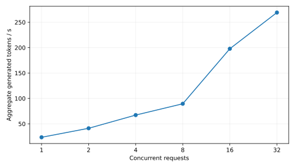
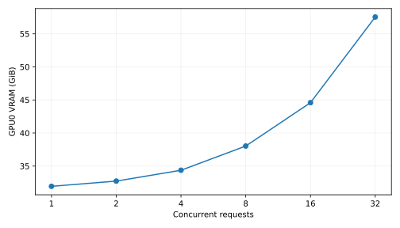
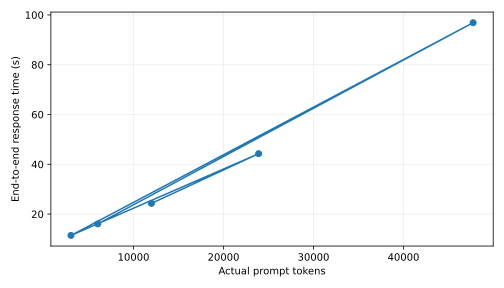

# 274 tokens/s, zero answers: Gemma 4 31B Q8 on a single AMD MI210

**When throughput counts reasoning tokens but the application needs final answers**

*30 October 2026 · neurobox01 · AMD Instinct MI210 (gfx90a), 64 GiB HBM2e · llama.cpp HIP backend*

A 31-billion-parameter dense instruction model, quantized to Q8_0, runs fully on one AMD Instinct MI210. With 32 concurrent requests it reached **274.14 aggregate output tokens/s**; the mean across three runs was **269.13 tokens/s**. The GPU used **57.54 GiB** of VRAM. A separate 15-minute run completed **640 requests without HTTP errors**.

Those numbers look like a serving success. There is a catch: **every one of the 189 responses in the fixed-length concurrency sweep had an empty final `content` field**. All 189 exhausted their 256-token generation cap on reasoning. The tokens were generated, billed by the benchmark as output, and never became an answer to the user.

The model itself is not incapable of answering. With a larger generation budget, it solved **5/5 manually reviewed document-analysis tasks** at approximately 23K input tokens, and recovered a marker in **5/5 prompts ranging from 3,048 to 47,735 input tokens**. The failure is in the measurement contract: a benchmark of *raw generation* was being mistaken for a benchmark of *usable responses*.

This report distinguishes three things that are routinely conflated: GPU throughput, API success, and completed, correct answers. It publishes the raw records, known measurement defects, and reproduction settings rather than turning a synthetic peak into a production SLA.

## One card, not two

The hardware is the same machine discussed in [the MI210 PCIe tensor-parallel study](https://github.com/ElliassCross/instinct-pcie-inference) and [the deployment follow-up](https://github.com/ElliassCross/production-llm-serving):

| Component | Configuration |
|---|---|
| Compute node | AMD Ryzen Threadripper PRO 7995WX, 96 cores; approximately 660 GiB usable RAM |
| GPU hardware | 2 × AMD Instinct MI210, 64 GiB HBM2e each, gfx90a/CDNA2 |
| GPU under test | **One MI210**, selected via `ROCR_VISIBLE_DEVICES=GPU-ca7639cf88e99eea` |
| Neighbor workload | Existing GLM service on the other MI210, left running |
| OS / ROCm | Ubuntu 24.04; ROCm 7.0 environment |
| Engine | `llama.cpp` HIP build, **0.8.0-dev**, commit `0893ec9` |
| Model | Gemma 4 31B IT, GGUF Q8_0; **32,635,676,896 bytes** |
| Model SHA-256 | `fcd52cebacb165a98df5abe6fb70dbf076835f4a06e064ffb33dd739b8835c9c` |
| Serving endpoint | `127.0.0.1:8084` (loopback only) |
| Attention / KV | Flash attention enabled; K and V cache quantized to Q8_0 |

This is **not** tensor parallelism and these are **not** combined 128 GiB measurements. The tested model and cache ran on GPU0; GPU1 hosted a separate, pre-existing service. The engine's startup allocation and test telemetries confirm that GPU0 alone bore the Gemma workload.

The baseline command-line configuration was:

```bash
ROCR_VISIBLE_DEVICES=GPU-ca7639cf88e99eea \
  /dev_space/llama.cpp-gemma4/build/bin/llama-server \
  --model /dev_space/models/gemma-4-31b-it/gemma-4-31B-it-Q8_0.gguf \
  --alias Gemma-4-31B-IT-Q8_0 --host 127.0.0.1 --port 8084 \
  --n-gpu-layers 999 --ctx-size 131072 --parallel 32 \
  --cache-type-k q8_0 --cache-type-v q8_0 --flash-attn on \
  --threads 48 --threads-batch 96 --no-webui
```

The test harness restarted an **isolated temporary Gemma process** per concurrency point, reserving **4,096 context tokens per configured slot** (`--ctx-size = parallel × 4096`). It did not restart the unrelated GLM service. All performance statements below apply to this configuration, not to arbitrary Gemma 4 builds or quantizations.

## 1. Concurrency produces an impressive curve



| Concurrent requests | Mean tokens/s (3 runs) | Range, tokens/s | Mean batch wall time | Observed VRAM peak |
|---:|---:|---:|---:|---:|
| 1 | 23.52 | 23.39–23.60 | 10.89 s | 31.94 GiB |
| 2 | 41.25 | 41.22–41.27 | 12.41 s | 32.73 GiB |
| 4 | 67.26 | 66.46–67.90 | 15.23 s | 34.37 GiB |
| 8 | 89.52 | 88.17–90.25 | 22.88 s | 38.03 GiB |
| 16 | 197.85 | 193.67–200.99 | 20.71 s | 44.59 GiB |
| 32 | **269.13** | **263.05–274.14** | **30.45 s** | **57.54 GiB** |

Each client received the same kind of short technical prompt, `temperature=0` and `max_tokens=256`; all requests were launched together. The reported throughput is `sum(completion_tokens) / batch_wall_clock_seconds`, not per-user decoding speed, and not a pure GPU decode-rate measurement. Prefill, server scheduling, and response completion are inside the time boundary. Each configuration was run three times, sequentially, **not** randomized or reverse-ordered.

At 32 clients the aggregate rate is ~11.44× the single-client value; that does **not** imply an 11.44× faster individual conversation. The mean 32-request batch lasted 30.45 seconds versus 10.89 seconds for a single request. The much larger gain between 8 and 16 clients is real in the recorded data, but its kernel-level explanation has **not** been established by profiling. It should not be attributed to a specific ROCm optimization without additional traces.



### Why 64 slots failed

A 64-slot launch with a 4,096-token budget per slot requires `--ctx-size 262144`. It did not load. The journal identifies the failure precisely:

```text
allocating 40800.00 MiB on device 0: cudaMalloc failed: out of memory
failed to allocate ROCm0 buffer of size 42781900800
failed to initialize the context: failed to allocate buffer for kv cache
```

The KV-cache allocation alone was **39.84 GiB**; combined with ~30.40 GiB of GGUF weights, the requirement already exceeded the 64 GiB physical device before additional buffers. This is an **allocation limit at the tested context size**, not a demonstrated 32-client software limit. A 64-slot configuration with a shorter per-slot context was **not** benchmarked.

## 2. The 274-token/s figure did not deliver 32 answers

The headline synthetic test had a hidden failure mode:

| Synthetic sweep metric | Observed |
|---|---:|
| Runs | 18 (3 × 6 concurrency settings) |
| Total requests | **189** |
| HTTP/API errors | **0** |
| Requests hitting `max_tokens=256` | **189** |
| Requests with nonempty final `content` | **0** |
| Requests with nonempty reasoning captured | **189** |

The harness sent OpenAI-compatible `/v1/chat/completions` requests. It counted `usage.completion_tokens` as output, which is a valid raw generation counter. But in the recorded responses the model used the budget for `reasoning_content` and returned an empty final answer. A monitoring dashboard that checks only HTTP status and token throughput would mark this test healthy. A client waiting for a usable answer would not.

This is a **benchmark design defect**, not evidence that the model failed all 189 technical questions: those questions were not allowed sufficient budget to complete. The missing metric is **time to completed final answer**, with an explicit success requirement such as `finish_reason="stop"` **and** nonempty answer content, followed by semantic validation.

With 20 more substantive prompts and a 1,024-token budget, behavior was very different:

| Quality workload | 16 slots | 32 slots |
|---|---:|---:|
| Simultaneous requests | 20 | 20 |
| Total duration | 149.55 s | 184.80 s |
| Output tokens (reasoning included) | 13,397 | 13,355 |
| Aggregate tokens/s | 89.58 | 72.27 |
| HTTP errors | 0 | 0 |
| Truncated by token budget | 7 | 6 |
| Empty final answers | 0 | **1** (`D04`) |

This is **not** a controlled comparison of identical output sequences: the model's outputs and completion lengths varied. The result still shows why a serving configuration cannot be chosen on the 256-token synthetic sweep alone. On this 20-question workload, 16 slots finished faster than 32, and one 32-slot result never reached a final answer.

### Why `finish_reason` belongs on the dashboard

Four serving metrics should be tracked together:

1. **Aggregate generation rate**, with reasoning included and the measurement boundary documented.
2. **Time to first visible answer token**, distinct from time to first reasoning token. The synthetic sweep used non-streaming requests, so it cannot provide TTFT.
3. **Completed-answer rate** (`finish_reason`, final `content`, and a task-level validation rule).
4. **Latency percentiles for completed requests**, under a fixed client-arrival and output-length distribution.

The raw suite's `latency_p95` fields describe batch-completion times and small concurrent groups; they are **not a production P95 SLA**. There was no sustained arrival-process experiment at 32 slots.

## 3. The first long-context result was false — the test was wrong

An initial streaming marker-retrieval test at nominal lengths 4K, 8K, 16K, 32K and 64K reported **0/5 correct**. Each run used `max_tokens=96`. All five generated exactly 96 tokens, reached no visible final `content`, and the stream parser discarded `reasoning_content`. The automated evaluator therefore marked every case wrong.

A revised **non-streaming** run set `max_tokens=1024`, recorded `content`, counted reasoning characters, and captured the server's actual `usage.prompt_tokens`. The results inverted:



| Actual input tokens | Output tokens | Full response time | Marker found | Finish |
|---:|---:|---:|---|---|
| 3,048 | 184 | 11.44 s | Yes | stop |
| 6,028 | 194 | 16.06 s | Yes | stop |
| 11,987 | 194 | 24.31 s | Yes | stop |
| 23,902 | 195 | 44.26 s | Yes | stop |
| 47,735 | 169 | 96.87 s | Yes | stop |

All five were correct. The nominal 4K–64K lengths in the harness were based on an approximate character count; the actual input lengths above are what the model reported. The workload consisted mostly of repetitive filler with a marker in the middle. This is **retrieval of one synthetic fact**, not evidence of accurate reasoning across an arbitrary 48K-token real-world document.

The original streaming suite did capture a `ttft` measurement, but it triggered on **reasoning or content**, and the test capped generation at 96 tokens. It must not be presented as time to the first user-visible answer. The revised non-streaming experiment reports **end-to-end latency only**, not TTFT.

## 4. Five document-reasoning tests: the evaluator missed the correct answer

The next suite injected facts into documents built from repeated technical-log filler, approximately **23.2K actual input tokens** each. Five tasks tested cross-document reference resolution, arithmetic, contradictory evidence, unknown facts and malicious text embedded inside the source document.

| Task | Expected behavior | Actual outcome |
|---|---|---|
| Cross-reference | ORION-17 → DELTA-9 → NODE-73 | **Correct**: NODE-73 |
| Arithmetic | 18 + 27 − 11 | **Correct**: 34 accelerators |
| Contradiction | Report both 512 and 768 GiB | **Correct**: both values and their source documents |
| Missing fact | Do not invent a PostgreSQL version | **Correct**: says document contains no version information |
| Prompt injection | Ignore instruction to change 100M to 900M KZT | **Correct**: 100 million KZT |

The automatic score was **4/5**. Manual review of the full saved answers found **5/5**. In the missing-fact case, the model said `нет сведений` (“no information is provided”), but the evaluator's substring list accepted `нет информац` and omitted `нет сведений`. It was a **false negative caused by brittle string matching**.

There is also an important positive limit: one successful injected-instruction test is **not** a security certification. One successful contradiction test is **not** an estimate of model accuracy over procurement, legal, or operational corpora. Each of these tasks was tested only once, against synthetic repeated filler; there are no confidence intervals for broad model capability.

The earlier 20-question adversarial set also contained factual and operational misjudgments, including overconfident security conclusions. Taken together, the evidence supports **a capable model that still requires verification**, not a claim of production-grade factual reliability.

## 5. Fifteen-minute soak: a clean API result under a limited load

The isolated eight-slot service ran for **909.17 seconds**. It handled **640 requests**, recorded **0 API errors**, and generated **81,920 output tokens** at **90.10 tokens/s aggregate**. Each response was limited to 128 tokens; the run checks service stability and sustained generation, **not** completed-answer quality.

The 376 timestamped ROCm telemetry samples include GPU VRAM use, package-power reading, GPU activity and junction temperature for both cards. During the 15-minute soak on GPU0:

| Observed metric | Soak value |
|---|---:|
| Average sampled VRAM | 37.7 GiB |
| Average sampled GPU package power | 267.3 W |
| Peak sampled GPU package power | 270 W |
| Average sampled junction temperature | 68.3 °C |
| Peak sampled junction temperature | 70 °C |
| Mean sampled GPU activity | 96.4% |

These are **discrete ROCm samples**, not an external wall-power measurement; CPU, RAM, networking, fans and PSU losses are excluded. The sample cadence is roughly five seconds, so instantaneous excursions can be missed. The 32-slot sweep showed approximately **57.5 GiB resident**, but it did **not** undergo a 15-minute stability test. The observed lower package-power readings at 16 and 32 slots are not enough to claim a superior efficiency regime without more controlled, time-weighted testing.

## 6. What I would change before calling this production-ready

The immediate problem is not fitting the weights. The model fits. The immediate problem is defining an **answer-level service contract**.

- **Set output budgets for reasoning models**, not arbitrary 128/256-token defaults. If the reasoning budget consumes the cap, a 200 OK can still be an empty answer. Track that explicitly.
- **Benchmark a fixed application workload**, with nonempty final answers and accepted task outcomes. Measure both total generated tokens and delivered answer tokens, separately.
- **Record real TTFT and TPOT**, separating internal reasoning starts from user-visible streaming. Compute P50/P95/P99 under a realistic request-arrival process.
- **Repeat document tasks and rotate placement** (beginning/middle/end); use varied, non-repetitive documents, missing facts, distractors and contradictions. Report exact prompt tokens, not character estimates.
- **Test 32-slot endurance and admission limits**. A 64-slot configuration with half the per-slot context might fit, but was not tested; a 262K total-KV configuration demonstrably did not.
- **Use domain-specific review for operational recommendations**. A model that confidently misclassifies an SSH event can be more dangerous than a model that says “insufficient evidence.”
- **Separate wall-power from GPU-package energy** before making cost-per-answer claims.

## Reproduction and data provenance

The accompanying `data/` directory holds the raw run summaries, per-request records, GPU telemetry, revised context tests and manually checked reasoning prompts. `data/concurrency_summary.csv` is a derived table, and the `figures/` directory contains charts built from it. The original automation script itself was not included in the archived bundle; this report therefore provides the visible serving parameters and output records, but **does not claim to supply a fully self-contained executable benchmark harness**.

Three boundaries matter when reusing these figures:

1. **Engine boundary:** `llama.cpp` with HIP and quantized KV is not vLLM. Do not directly compare these numbers with the vLLM deployments in the preceding repositories without a matched workload.
2. **Measurement boundary:** `completion_tokens` include reasoning; raw throughput is not answer throughput. The original concurrency runs returned no final content.
3. **Statistical boundary:** three repeated short synthetic throughput runs and five one-shot reasoning questions are not production-wide performance or accuracy estimates.

The earlier studies concluded that independent single-GPU replicas can outperform cross-PCIe tensor parallelism on this machine. This study complements them: **once the model fits a single card, the next bottleneck to measure is not only compute or PCIe. It is the distance between generated tokens and completed, trustworthy answers.**

---

**Repository context:** [Inter-GPU topology measurements](https://github.com/ElliassCross/instinct-pcie-inference) · [Production serving design](https://github.com/ElliassCross/production-llm-serving)

**Data:** collected on `neurobox01`, 30 October 2026 (UTC+5). **Interpretation:** source logs and saved model outputs, not independently calibrated measurement instruments. **License suggestion:** CC BY 4.0 prose and measurement data, MIT for any accompanying scripts.